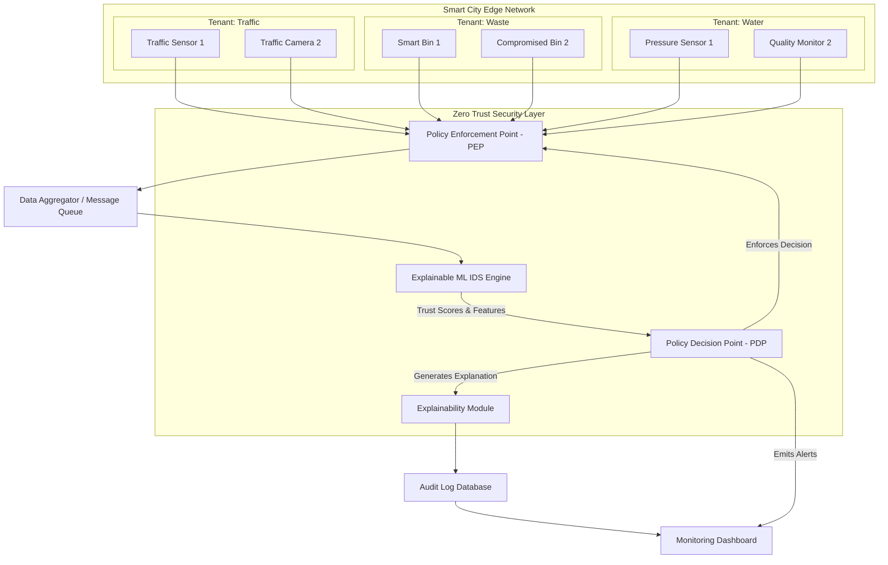

# Smart City Zero-Trust Architecture

This document describes the high-level architecture of the **Explainable Adaptive Zero-Trust IDS for Multi-Tenant Smart-City Edge Simulation**.

## Architecture Diagram

## Component Details

1. **Smart City Edge Network (Tenants)**
   - The simulation generates synthetic IoT telemetry. 
   - Tenants are logically isolated: Traffic, Waste, and Water management. Each has distinct device profiles.

2. **Policy Enforcement Point (PEP)**
   - Operates as the gateway/firewall.
   - Drops or rate-limits traffic based on dynamic policies sent by the PDP. 

3. **Data Aggregator**
   - Buffers incoming device data to be processed by the ML IDS.

4. **Explainable ML IDS Engine**
   - Evaluates aggregated telemetry against baseline normal behavior.
   - Outputs continuous Trust Scores and flags potential anomalies.

5. **Policy Decision Point (PDP)**
   - Translates raw ML trust scores and predefined rules into actions (`Allow`, `Monitor`, `Restrict`, `Isolate`).
   - Ensures cross-tenant segmentation logic (e.g., isolating a waste bin without halting the water sensors).

6. **Explainability Module & Audit Logs**
   - Converts the raw feature flags and IDS outputs into human-readable, structured JSON logs.
   - Captures who, what, why, and the exact policy action applied.

7. **Monitoring Dashboard**
   - A visual frontend (e.g., Streamlit) displaying system health, current trust scores, real-time alerts, and evidence explanations.
